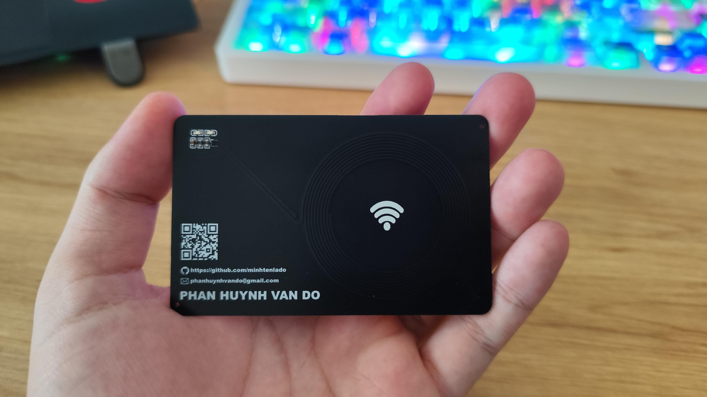
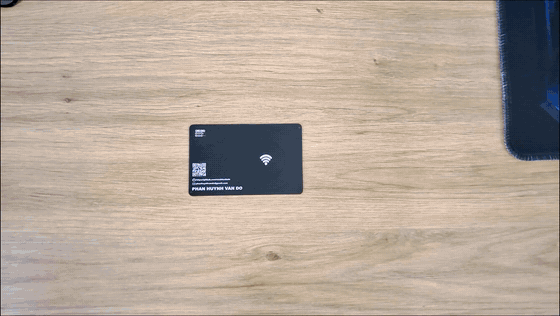
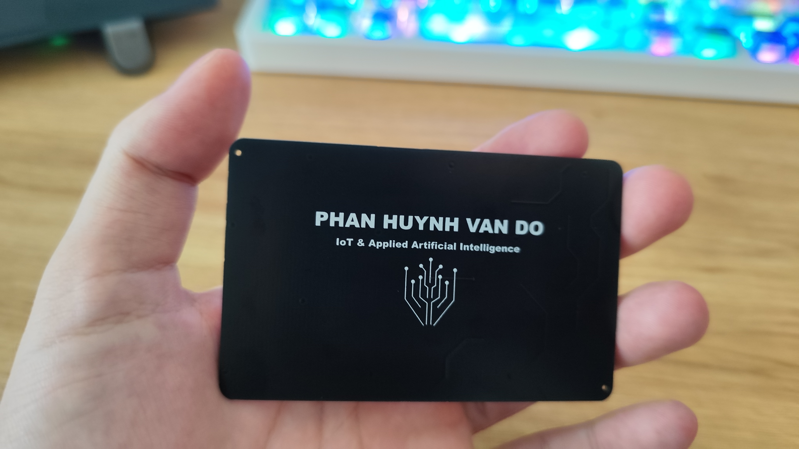
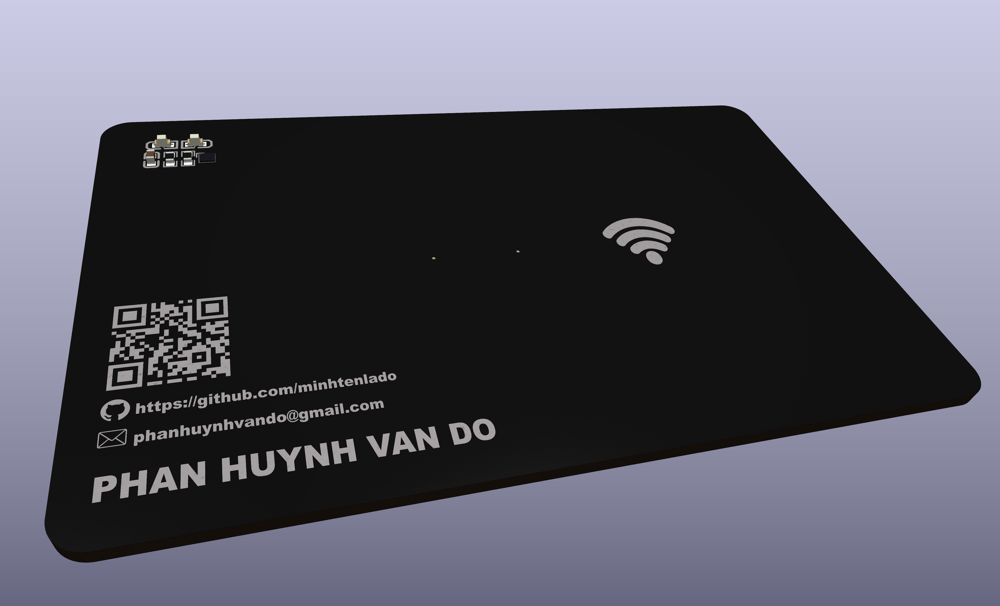
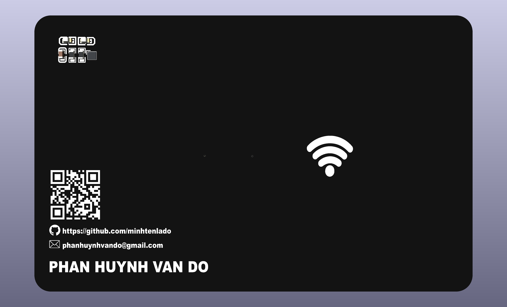
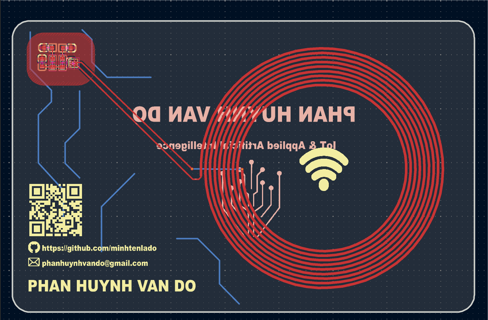
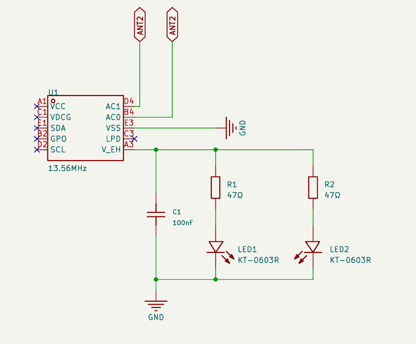
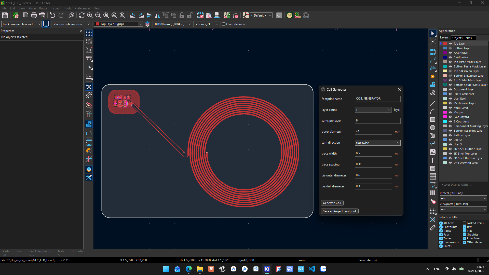

<div align="center">

# NFC LED — Battery-Free Energy Harvesting PCB

**A working, credit-card-sized NFC circuit powered directly by a smartphone's 13.56 MHz magnetic field.**

No battery · No USB power · No microcontroller firmware · Custom PCB spiral antenna




<sub>Actual fabricated PCB — not a rendering.</sub>

[**▶ Live GIF demo**](#-live-hardware-demonstration) · [**Photos**](#-real-hardware--gallery) · [**Hardware**](#-hardware-overview) · [**PCB coil settings**](#-pcb-coil-creator-settings) · [**First-time ST25 setup**](#-first-time-st25-nfc-tap-configuration) · [**Manufacturing**](#-manufacturing-files)

</div>

---

## ✨ Project overview

**NFC LED** is a standalone, battery-free electronics project built around the **STMicroelectronics ST25DV04KC-JF6L3**, a miniature NFC Forum Type 5 dynamic tag with an **energy-harvesting output (`V_EH`)**.

A planar spiral coil etched directly into the PCB captures energy from the NFC field generated by a compatible smartphone or reader. When energy harvesting is enabled and the available RF power is sufficient, the IC makes harvested power available at `V_EH`, allowing **two on-board LEDs** to illuminate without an external supply.

The PCB has been **fabricated, assembled and successfully tested**. This repository contains the editable KiCad project, 3D model, actual PCB photos, an animated hardware demonstration and production exports.

### Highlights

- **Zero external power:** no battery, charging circuit or wired power supply.
- **Tiny NFC IC:** ST25DV04KC-JF6L3, **WLCSP-10** package.
- **Integrated antenna:** approximately nine-turn circular copper spiral on the PCB.
- **Two visible LEDs:** a simple, immediate demonstration of harvested RF energy.
- **Reproducible design files:** KiCad schematic, PCB, 3D model, and Gerber/drill exports.
- **Smartphone configuration:** set the nonvolatile ST25 energy-harvesting mode through the **ST25 NFC Tap** Android app; no firmware flashing required.

> **Important:** The board demonstrates **NFC energy harvesting**. It is not a wireless-charging module capable of delivering arbitrary power: the LEDs depend on reader power, placement, coupling, and the configured harvesting mode.

## 🎬 Live Hardware Demonstration

<div align="center">

### Battery-Free NFC LED — Real Hardware Demo



<sub>Real hardware demonstration · NFC energy harvesting at 13.56 MHz · Battery-free LED operation</sub>

</div>

## 📸 Real hardware & gallery

### Fabricated PCB — both sides

<table>
  <tr>
    <td width="50%" align="center"></td>
    <td width="50%" align="center"></td>
  </tr>
  <tr>
    <td align="center"><sub>Real PCB — front / antenna side</sub></td>
    <td align="center"><sub>Real PCB — back / artwork side</sub></td>
  </tr>
</table>

### KiCad 3D renders



<table>
  <tr>
    <td width="50%" align="center"></td>
    <td width="50%" align="center"></td>
  </tr>
  <tr>
    <td align="center"><sub>3D — component / top side</sub></td>
    <td align="center"><sub>3D — reverse side</sub></td>
  </tr>
</table>

### Copper layout and schematic



<div align="center">
  
  <br />
  <sub>Schematic: NFC coil → ST25DV04KC energy harvesting → two LED branches.</sub>
</div>

[View the original schematic PDF](schematic.pdf) · [Open the KiCad schematic](NFC_LED_ST25DV.kicad_sch) · [Open the PCB layout](NFC_LED_ST25DV.kicad_pcb)

## 🔌 Hardware overview

| Item | Specification / implementation |
| :-- | :-- |
| Main NFC IC | **ST25DV04KC-JF6L3** — 4 Kbit dynamic NFC tag, WLCSP-10 |
| Wireless interface | **13.56 MHz**, ISO/IEC 15693, NFC Forum Type 5 |
| Antenna | PCB-etched, circular spiral coil |
| Coil construction | 9 turns, single copper layer; routed to the IC with a return connection |
| LEDs | **2 × 0603 SMD red LEDs** (`LED1`, `LED2`) |
| LED current limiting | **2 × 47 Ω** (`R1`, `R2`), one resistor per LED |
| Decoupling | **100 nF** (`C1`) on the harvested-energy output |
| Power rail | `V_EH` from ST25DV04KC (no external supply) |
| PCB | **2 copper layers**, approximately **85.6 × 54 mm**, 1.6 mm nominal thickness |
| Design software | KiCad |
| Operating principle | **RF field → coil → ST25DV energy harvesting → LED load** |

### Circuit operation

```text
         NFC-enabled smartphone / RFID reader
                       │
                13.56 MHz RF field
                       │
           Custom circular PCB antenna
                       │ AC0 / AC1
              ST25DV04KC-JF6L3
                       │ V_EH
             ┌─────────┼──────────┐
             │         │          │
          C1 100nF   R1 47Ω     R2 47Ω
             │         │          │
             │        LED1       LED2
             │         │          │
             └─────────┴──────────┘
                       │
                      GND
```

`V_EH` is an **unregulated** output. LED brightness and power availability vary with the RF reader, antenna alignment, separation, coupling and load. Avoid assuming a fixed output voltage.

## 🌀 PCB Coil Creator settings

This project's antenna was designed with a **circular spiral PCB coil generator**. The settings below were transcribed directly from the included `images/Coil_creator.png` screenshot, rather than estimated from the finished board.



| Generator setting | Value used |
| :-- | :-- |
| Footprint name | `COIL_GENERATOR` |
| Layer count | `1` |
| Turns per layer | `9` |
| Outer diameter | `44 mm` |
| Turn direction | `clockwise` |
| Trace width | `0.50 mm` |
| Trace spacing | `0.36 mm` |
| Via outer diameter | `0.60 mm` |
| Via drill diameter | `0.30 mm` |

**Trace pitch:** `0.50 + 0.36 = 0.86 mm` between adjacent trace centerlines, as a nominal input setting.

### Generate or reproduce the antenna in KiCad

1. Install **[PCB Coil Creator](https://github.com/DIaLOGIKa-GmbH/kicad-coil-creator)** from KiCad's **Plugin and Content Manager** (KiCad 7 or newer) or install the plugin's release ZIP with **Install from File**.
2. Open **PCB Editor** and launch the coil tool from the external/add-on plugin area. Depending on the installed version, the dialog may be labelled **Coil Generator**.
3. Select a **circular coil** and enter the settings listed in the table; choose the **front copper** layer for the spiral.
4. Use **Generate Coil** to preview/place the geometry, or **Save as Project Footprint** to preserve it as a reusable footprint, where supported by the plugin.
5. Route the two coil terminals to the IC's `AC0` and `AC1`. Where necessary, use a short back-layer return connection and vias so traces do not cross on the same layer.
6. Check clearance, board-edge spacing, coil continuity and manufacturing limits in KiCad. Verify that large copper fills and metallic objects do not interfere with the coil.
7. **Do not assume the settings alone guarantee resonance at 13.56 MHz.** The actual inductance, total capacitance, resonance and performance depend on PCB stack-up and assembly; measure/tune the finished antenna when adapting the design.

> The screenshot above represents the **settings of this specific design**. Plugin appearance and exact control names can change between KiCad/plugin versions. The coil occupies one layer, while the **overall PCB is two-layer**.

## 📱 First-time ST25 NFC Tap configuration

**You do not flash MCU firmware to this board.** To enable the battery-free LED demonstration on a *new* ST25DV04KC device, configure its **nonvolatile energy-harvesting register** through the NFC interface.

### What you need

- Android phone with NFC enabled.
- **[ST25 NFC Tap — official Android app](https://play.google.com/store/apps/details?id=com.st.st25nfc)** by STMicroelectronics.
- Assembled NFC LED PCB; no battery or external supply.

### One-time setup

1. Turn on **NFC** in Android settings and open **ST25 NFC Tap**.
2. Hold the phone's NFC antenna close to the PCB spiral until the app detects the **ST25DV** tag (ISO/IEC 15693 / Type 5). The optimal phone position varies by model.
3. Open the app menu and enter **Register Management** (or the equivalent register/configuration screen in your app version).
4. Find the **static `EH_MODE`** configuration register (RF configuration register address **`0x02`**).
5. Set **`EH_MODE = 0x00`** — **energy harvesting enabled automatically after boot**, whenever sufficient RF power is present. Preserve other reserved bits and unrelated registers.
6. Press **Save / Write**. If the application asks for the **RF configuration password**, authenticate using the correct password for your tag. A factory-new, unmodified tag normally uses the default all-zero **64-bit** configuration password; do not assume this applies to a previously configured device.
7. Read back the register and confirm **`EH_MODE = 0x00`**. Remove the phone, then tap the PCB again to test power harvesting and LED illumination.

| Register / bit | Meaning |
| :-- | :-- |
| `EH_MODE = 0` (**static**, nonvolatile) | Enables automatic harvesting after boot when RF energy is sufficient |
| `EH_MODE = 1` (factory default) | On-demand harvesting; initially disabled after boot |
| `EH_EN` (**dynamic**) | Temporarily enable/disable energy harvesting without changing the saved default |
| `EH_ON` (**dynamic**, status) | Indicates whether the harvesting function is enabled |

**Why static `EH_MODE` matters:** Changing only the **dynamic `EH_EN`** bit can turn on energy harvesting for the current RF session, but it does **not** save the startup behavior for later taps. Set **static `EH_MODE = 0`** for this demonstration.

> **Troubleshooting:** If LEDs do not light, confirm the register was actually saved, try a different phone position and NFC antenna orientation, and ensure the phone maintains its NFC field. Harvesting may affect RF communication while the LEDs draw power. Some phones provide less power than others. Never change passwords or protection/lock settings unless you intend to manage them.

**ST documentation:** [ST25DV04KC datasheet](https://www.st.com/resource/en/datasheet/st25dv04kc.pdf) · [ST25 NFC Tap software](https://www.st.com/en/embedded-software/stsw-st25001.html) · [ST25 NFC Tap user manual (UM2131)](https://www.st.com/resource/en/user_manual/um2131-st25-android-nfc-tap-application-stmicroelectronics.pdf)

<details>
<summary><strong>🇻🇳 Xem hướng dẫn cấu hình nhanh bằng tiếng Việt</strong></summary>

### Tạo cuộn anten trong KiCad

Cài **PCB Coil Creator** từ *Plugin and Content Manager*, sau đó mở công cụ trong **PCB Editor**. Nhập thông số theo đúng ảnh `images/Coil_creator.png`: **1 lớp cuộn, 9 vòng, đường kính ngoài 44 mm, xoắn theo chiều kim đồng hồ, rộng đường đồng 0,5 mm, khoảng cách 0,36 mm, via 0,6 mm và lỗ khoan 0,3 mm**. Nhấn **Generate Coil**, sau đó nối hai đầu anten với `AC0` và `AC1` của ST25DV04KC.

### Cấu hình chip ST25DV04KC lần đầu

1. Bật **NFC** trên điện thoại Android và cài ứng dụng **ST25 NFC Tap** chính hãng.
2. Áp điện thoại vào vị trí anten trên PCB để ứng dụng nhận diện tag **ST25DV**.
3. Vào mục **Register Management** (tên menu có thể khác giữa các phiên bản).
4. Tìm **thanh ghi tĩnh `EH_MODE` (địa chỉ RF `0x02`)**, đổi giá trị thành **`0x00`**.
5. Nhấn lưu/ghi. Nếu ứng dụng yêu cầu mật khẩu cấu hình RF, chip mới chưa đổi mật khẩu thường có mật khẩu mặc định gồm **64 bit bằng 0**; nếu đã đổi thì phải dùng mật khẩu thực tế.
6. Đọc lại để xác nhận `EH_MODE = 0x00`, đưa điện thoại ra xa rồi áp lại để kiểm tra LED.

**Lưu ý:** Chỉ bật `EH_EN` ở thanh ghi động sẽ **không lưu chế độ khởi động**. Muốn tự bật Energy Harvesting ở những lần quét tiếp theo phải cấu hình `EH_MODE = 0x00`. Đây là **ghi cấu hình EEPROM**, không phải nạp firmware.

</details>

## 🏭 Manufacturing files

The `production/` folder contains fabrication and assembly exports supplied with this project.

| File | Use |
| :-- | :-- |
| [`production/NFC_LED_ST25DV.zip`](production/NFC_LED_ST25DV.zip) | Gerber layers, outline and drilling information for a PCB fabrication service |
| [`production/bom.csv`](production/bom.csv) | BOM / assembly export |
| [`production/positions.csv`](production/positions.csv) | Pick-and-place coordinates |
| [`production/designators.csv`](production/designators.csv) | Component designator export |
| [`production/netlist.ipc`](production/netlist.ipc) | IPC-format netlist export |

The manufacturing ZIP contains both copper Gerbers, mask/paste, silkscreen, outline and drill files. **Confirm BOM values and part sourcing independently before submitting another assembly order**: the existing BOM export has blank value/part-number columns, even though the KiCad schematic records the resistor and capacitor values.

### Reopen or customize in KiCad

1. Clone/download the repository.
2. Open `NFC_LED_ST25DV.kicad_pro` in KiCad.
3. Inspect `NFC_LED_ST25DV.kicad_sch` and `NFC_LED_ST25DV.kicad_pcb`.
4. The custom 3D IC model is included at [`library/ST25DV04KC-JF6L3.step`](library/ST25DV04KC-JF6L3.step); the board's model path is project-relative.
5. Re-run ERC/DRC and regenerate production files after changing the design. Recheck antenna tuning if you modify the coil, stack-up, copper thickness, or layout near it.

## 📂 Repository structure

```text
NFC_LED_ST25DV/
├── README.md
├── .gitignore
├── NFC_LED_ST25DV.kicad_pro
├── NFC_LED_ST25DV.kicad_sch
├── NFC_LED_ST25DV.kicad_pcb
├── schematic.pdf
├── images/
│   ├── Actual_photo(1).jpg
│   ├── Actual_photo(2).jpg
│   ├── board_3D.png
│   ├── board_3D_top.png
│   ├── board_3D_bottom.png
│   ├── Coil_creator.png
│   ├── Footprint.png
│   ├── schematic.png
│   └── NFC_LED_ST25DV_full_demo.gif
├── library/
│   └── ST25DV04KC-JF6L3.step
├── production/
│   ├── NFC_LED_ST25DV.zip
│   ├── bom.csv
│   ├── positions.csv
│   ├── designators.csv
│   └── netlist.ipc
```

KiCad local history (`.history/`), lock files and user-local `.kicad_prl` settings are excluded from the clean distribution; they are not required to manufacture or inspect the board.

## 🔗 References

- [ST25DV04KC official product page](https://www.st.com/en/nfc/st25dv04kc.html)
- [ST25DV04KC / ST25DV16KC / ST25DV64KC datasheet](https://www.st.com/resource/en/datasheet/st25dv04kc.pdf)
- [ST25 NFC Tap for Android](https://play.google.com/store/apps/details?id=com.st.st25nfc)
- [ST25 NFC Tap user manual](https://www.st.com/resource/en/user_manual/um2131-st25-android-nfc-tap-application-stmicroelectronics.pdf)
- [KiCad PCB Coil Creator plugin](https://github.com/DIaLOGIKa-GmbH/kicad-coil-creator)

---

<div align="center">

**Designed, fabricated & tested by Phan Huynh Van Do**

*Embedded hardware · PCB engineering · NFC energy harvesting*

</div>
